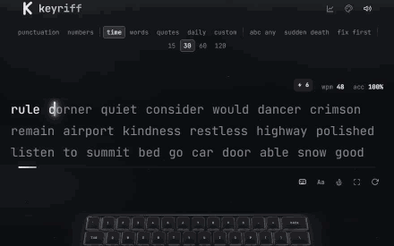
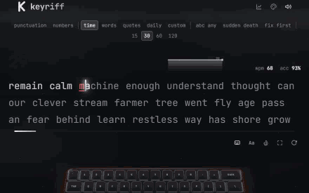
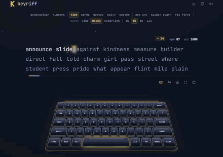

# takt — find your rhythm

A beautiful, local-first typing trainer. Everything runs and stays in your browser — no accounts, no tracking, no network.

## Showcase


*Live test on ghost + spectre: countdown punch, momentum sparkline, streak, reactive backdrop.*


*Same test across ghost, synthwave and sakura — every theme carries its own ambient animation.*


*Deck, monolith and halo ring boards on midnight, mid-run.*

## Features

- **Modes** — time (15/30/60/120s), words (10/25/50/100), quotes, custom text, a **weak-key practice drill** built from your own mistake stats, and a **daily challenge**: the same seeded test for everyone each day
- **Modifiers** — punctuation, numbers, word-length tiers (short/any/long), force-correct mode, and **sudden death** (one mistake ends the test)
- **5 keyboard styles** — spectre (ghost-minimal outline), onyx (black glass), deck (steep tall console), monolith (towering caps, sculpted profile), halo ring (backlit slit glow) — pairable with any of the **11 sound packs**
- **36 themes** — grouped hero / core / light, each with an ambient animation that suits its mood: aurora, starfield (shooting stars), gradient mesh (orbiting ring), vapor grid (neon sun + scanline), matrix rain, embers, snow, bubbles, petals, scanline drift; hover any theme for a live preview; all palettes audited for WCAG contrast
- **Living background** — the backdrop charges with your rolling speed and simmers when you stall; calm at idle, electric mid-race
- **Live feedback** — WPM/accuracy, momentum-colored sparkline with live badge, correct-streak with milestone sounds, countdown ticks, red-line final-seconds progress, live WPM in the tab title
- **Results** — count-up stats with shimmer numerals, WPM-over-time chart with above/below-PB coloring, error markers and PB line, consistency ring gauge, keyboard **replay** of your exact keystrokes (seek + speed), flair-aware shareable result card (copy image or save PNG), confetti + particle burst on personal bests
- **3D keyboard** — physical key highlighting, parallax tilt, weak-key heat map, error pulse, auto-scales from desktop down to phones
- **Sound engine** — 11 synthetic switch packs (tactile, topre, bubble, thock, clicky, typewriter, linear, glass, bamboo, abyssal, marble flagship) with per-row depth, per-column pitch ladder, **stereo panning across the keys**, rhythm-aware velocity + round-robin humanization, tape-style saturation, per-pack reverb; haptic tick on touch devices
- **Stats page** — totals, today card, day streak, WPM progression chart, 12-week activity heatmap, weak keys, personal bests, recent tests, plus export/import/reset of all your data
- **Mobile & PWA** — touch input with "tap to type", installable, fully offline (fonts precached), safe-area aware
- **Zen mode**, first-visit onboarding, `?showcase` autoplay demo mode, reduced-motion support, screen-reader live regions

## Controls

| Key | Action |
| --- | --- |
| `tab` | restart test |
| `esc` | back / exit zen |
| `enter` | new test (on results) |

## Development

```bash
npm install
npm run dev        # vite dev server
npm run lint       # oxlint
npm test           # vitest (engine + component tests)
npm run e2e        # builds, serves, and runs the Chrome viewport matrix
npm run build      # production build + PWA service worker
npm run icons      # regenerate PWA icons from the logo design
npm run showcase   # capture README GIFs (needs Chrome + dist build)
```

## Stack

Vite · React 19 · Tailwind CSS 4 · Framer Motion · Web Audio API · vite-plugin-pwa · vitest + Testing Library · puppeteer-core (e2e) · gifenc + jpeg-js (showcase capture, dev only)
